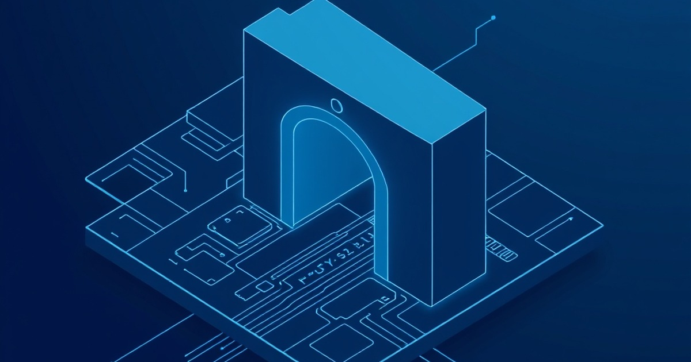

# dsh-our-free-model

A streamlined plugin for dsh to enable access to frontier models like DeepSeek V4.1 Flash and Kimi K3, without requiring individual user logins, sign-ups, or personal API keys.

## Features
- **Keyless Access**: Connect to frontier models immediately.
- **No Registration**: Skip the login/signup flow.
- **Seamless Integration**: Designed as a lightweight plugin for existing dsh environments.
- **High Performance**: Optimized middleware for low-latency requests.

## How it works
The tool acts as a middleware layer that manages authorized model sessions, abstracting the authentication complexity from the end-user while maintaining a performant inference stream. It utilizes internal session management to pool authenticated connections, which are then exposed through a simple API interface. This setup ensures that developers can focus on building applications rather than managing individual API credentials for every model provider.

## Setup
1. Clone this repository.
2. Ensure you have dsh installed in your environment.
3. Integrate the plugin into your existing model routing logic.

## Limitations
- Performance depends on the availability of the model gateways.
- Standard model usage policies apply.
- Not intended for heavy, high-concurrency production workloads; monitor throughput accordingly.

## License
MIT
